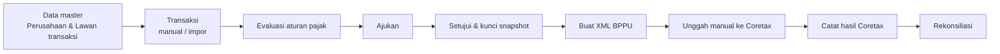
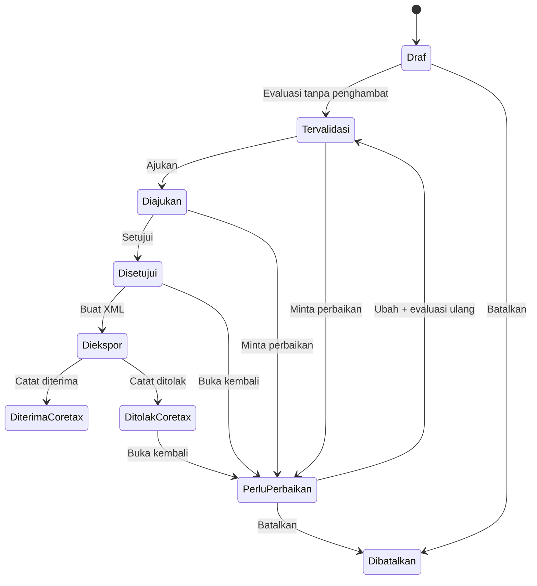

# Panduan Pengguna SerenTax

Panduan ini menjelaskan fitur SerenTax dan cara memakainya dari awal sampai akhir, dari sudut pandang **pelanggan berlangganan**: tim akuntansi atau pajak sebuah perusahaan yang menyiapkan bukti potong PPh Unifikasi (BPPU) untuk diimpor ke Coretax DJP.

> **Penting tentang posisi produk.** SerenTax adalah alat **persiapan dan peninjauan** dokumen pajak. SerenTax **tidak** melaporkan pajak atas nama Anda, **tidak** terhubung otomatis ke DJP/Coretax, dan bukan PJAP. Hasil akhirnya berupa berkas XML yang Anda **unggah sendiri** ke portal Coretax. Keputusan perpajakan tetap ada di tangan tim Anda.

---

## Daftar isi

1. [Gambaran singkat](#1-gambaran-singkat)
2. [Peran dan hak akses](#2-peran-dan-hak-akses)
3. [Memulai: akun, ruang kerja, tim, dan langganan](#3-memulai-akun-ruang-kerja-tim-dan-langganan)
4. [Mengenal tampilan aplikasi](#4-mengenal-tampilan-aplikasi)
5. [Cara memakai tampilan standar (list, form, wizard)](#5-cara-memakai-tampilan-standar-list-form-wizard)
6. [Data master: Perusahaan dan Lawan transaksi](#6-data-master-perusahaan-dan-lawan-transaksi)
7. [Transaksi](#7-transaksi)
8. [Impor spreadsheet](#8-impor-spreadsheet)
9. [Klasifikasi pajak, pengajuan, dan persetujuan](#9-klasifikasi-pajak-pengajuan-dan-persetujuan)
10. [Ekspor XML Coretax (BPPU)](#10-ekspor-xml-coretax-bppu)
11. [Rekonsiliasi](#11-rekonsiliasi)
12. [Pengaturan](#12-pengaturan)
13. [Alur end-to-end: satu masa pajak](#13-alur-end-to-end-satu-masa-pajak)
14. [Referensi status transaksi](#14-referensi-status-transaksi)
15. [Batasan saat ini](#15-batasan-saat-ini)
16. [Pertanyaan umum dan pemecahan masalah](#16-pertanyaan-umum-dan-pemecahan-masalah)

---

## 1. Gambaran singkat

| Modul           | Isi                               | Untuk apa                                                                                  |
| --------------- | --------------------------------- | ------------------------------------------------------------------------------------------ |
| **Transaksi**   | Transaksi, Impor spreadsheet      | Mencatat invoice (manual atau massal), menghitung pajak, lalu mengajukan dan menyetujuinya |
| **Data Master** | Perusahaan, Lawan transaksi       | Profil perusahaan pemotong (NPWP/NITKU) dan vendor/pelanggan                               |
| **Coretax**     | Ekspor XML, Rekonsiliasi          | Membuat berkas XML BPPU, mencatat hasil unggah Coretax, memantau selisih                   |
| **Pengaturan**  | Ruang kerja & tim, OCR, Langganan | Anggota tim, kebijakan persetujuan, OCR opsional, lisensi langganan                        |
| **Bantuan**     | Pusat bantuan                     | Panduan singkat di dalam aplikasi                                                          |

Alur kerja intinya:



---

## 2. Peran dan hak akses

Setiap anggota punya **satu peran** di setiap ruang kerja. Peran dirancang agar **pembuat dan pemberi persetujuan adalah orang yang berbeda** (pemisahan tugas).

| Tindakan                                                          | Pemilik | Admin | Penyusun | Peninjau | Pemberi persetujuan |
| ----------------------------------------------------------------- | :-----: | :---: | :------: | :------: | :-----------------: |
| Kelola tim, undangan, perusahaan, langganan                       |   ✅    |  ✅   |    –     |    –     |          –          |
| Kelola lawan transaksi                                            |   ✅    |  ✅   |    ✅    |    –     |          –          |
| Buat, ubah, dan batalkan draf transaksi; impor; lampirkan dokumen |    –    |   –   |    ✅    |    –     |          –          |
| Evaluasi aturan pajak                                             |    –    |   –   |    ✅    |    ✅    |          –          |
| Ajukan untuk tinjauan                                             |    –    |   –   |    ✅    |    –     |          –          |
| Minta perbaikan / buka kembali                                    |    –    |   –   |    –     |    ✅    |         ✅          |
| Setujui & kunci snapshot                                          |    –    |   –   |    –     |    –     |         ✅          |
| Buat XML dan catat hasil Coretax                                  |    –    |   –   |    ✅    |    ✅    |         ✅          |
| Lihat data dan menulis komentar                                   |   ✅    |  ✅   |    ✅    |    ✅    |         ✅          |

Catatan:

- **Pemilik/Admin tidak otomatis bisa menyusun atau menyetujui transaksi.** Untuk melakukannya, mereka perlu diberi peran tersebut lewat akun anggota yang sesuai.
- **Minimal dua orang** dibutuhkan untuk menyelesaikan satu transaksi sampai disetujui: satu **Penyusun** dan satu **Pemberi persetujuan**.
- Fitur **Admin Platform** hanya untuk tim internal SerenTax (Superadmin) dan tidak muncul di akun pelanggan.

---

## 3. Memulai: akun, ruang kerja, tim, dan langganan

### 3.1 Membuat akun

1. Buka halaman SerenTax, lalu klik **Buat akun**.
2. Isi nama, email, dan kata sandi (12–128 karakter), lalu klik **Buat akun**.
3. Buka email verifikasi dan klik tautannya.
4. Masuk lewat **Masuk** dengan email dan kata sandi Anda.

> Lupa kata sandi? Klik **Lupa kata sandi** di halaman masuk. Setelah kata sandi diatur ulang, semua sesi lama otomatis berakhir.

### 3.2 Membuat ruang kerja

Ruang kerja (workspace) adalah wadah data satu organisasi. Data antar ruang kerja terpisah sepenuhnya.

1. Setelah masuk, buka **Pengaturan → Ruang kerja & tim**.
2. Di bagian **Buat ruang kerja**, isi _Nama ruang kerja_ dan _Nama badan hukum_, lalu klik **Buat ruang kerja**.
3. Anda otomatis menjadi **Pemilik** ruang kerja tersebut.

### 3.3 Mengundang tim

1. Di **Pengaturan → Ruang kerja & tim**, isi email anggota dan pilih perannya (misalnya _Penyusun_ atau _Pemberi persetujuan_).
2. Klik **Undang anggota**. Anggota menerima email undangan yang berlaku **48 jam** dan hanya bisa dipakai sekali.
3. Anggota harus membuat atau masuk ke akun **dengan email yang diundang**, lalu membuka kembali tautan undangan dan klik **Terima undangan**.

Peran anggota bisa diubah atau dicabut dari daftar tim kapan saja. Ruang kerja selalu harus punya setidaknya satu Pemilik.

### 3.4 Mengaktifkan langganan

1. Buka **Pengaturan → Langganan**.
2. Masukkan **Kunci lisensi Berlanggan** dari pembelian Anda, lalu klik **Aktifkan lisensi**. Kunci disimpan terenkripsi.
3. Setelah aktif, panel **Kuota langganan** di Beranda menampilkan paket, jumlah transaksi bulan ini, dan sisa kuota.

Aturan kuota:

|                       | Uji coba (tanpa langganan)              | Langganan aktif                                 |
| --------------------- | --------------------------------------- | ----------------------------------------------- |
| Masa berlaku          | 72 jam sejak aktivasi (sekali per akun) | Selama lisensi aktif                            |
| Batas transaksi baru  | 1 per hari (WIB), total 3               | Sesuai paket per **bulan kalender WIB**         |
| Impor spreadsheet     | Maksimal 1 baris valid per impor        | Semua baris valid sekaligus (dalam batas kuota) |
| Membatalkan transaksi | Tidak mengembalikan kuota               | Tidak mengembalikan kuota                       |

Tombol **Validasi ulang** menyegarkan status lisensi dari penyedia. **Nonaktifkan** melepas lisensi dari ruang kerja ini.

---

## 4. Mengenal tampilan aplikasi

### Beranda (menu aplikasi)

Setelah masuk, Anda tiba di **Beranda**. Isinya ikon-ikon modul (Transaksi, Data Master, Coretax, Pengaturan, Bantuan). Klik ikon untuk membuka modul. Di bawahnya ada bagian **Sekilas**: ruang kerja aktif, kuota langganan, dan ringkasan rekonsiliasi (total transaksi, dalam tinjauan, disetujui, XML dibuat, diterima/ditolak Coretax).

### Bilah atas (navbar)

Dari kiri ke kanan:

- **☰** (hanya di HP): membuka menu samping.
- **Ikon kotak-kotak**: kembali ke Beranda (menu aplikasi).
- **Nama modul dan menunya**: misalnya _Transaksi · Impor spreadsheet_.
- **Ruang kerja aktif**: klik untuk berganti ruang kerja.
- **ID / EN**: ganti bahasa. Filter dan tema tetap dipertahankan.
- **Bulan/Matahari**: ganti tema gelap atau terang. Pilihan Anda diingat.
- **Avatar inisial**: menu pengguna (Profil & tim, Keluar).

### Menu samping (sidebar)

Berisi semua modul beserta menunya. Klik **Ciutkan menu samping** di bawah untuk menyisakan ikon saja. Pilihan ini diingat. Di HP, menu samping muncul sebagai laci dari kiri.

---

## 5. Cara memakai tampilan standar (list, form, wizard)

Semua layar data memakai pola yang sama, jadi setelah Anda menguasai satu layar, layar lain bekerja dengan cara yang sama.

### 5.1 Tampilan list (daftar)

```
[ + Baru ]  Transaksi ⚙        [ 🔍 Cari… (tag filter)  ⏷ ]   1–80 dari 120  ‹ ›
┌───┬──────────────┬────────────┬──────────────┬────────────┬──────────┐
│ ☐ │ Nomor invoice│ Tanggal    │ Lawan trans. │ Jumlah     │ Status   │
├───┼──────────────┼────────────┼──────────────┼────────────┼──────────┤
│ ☐ │ INV/001      │ 2026-11-12 │ PT Konsultan │ 25.000.000 │ Disetujui│ ← klik baris
└───┴──────────────┴────────────┴──────────────┴────────────┴──────────┘
```

| Ingin…                  | Caranya                                                                                                                                                                                                 |
| ----------------------- | ------------------------------------------------------------------------------------------------------------------------------------------------------------------------------------------------------- |
| **Membuka detail**      | Klik barisnya, di bagian mana saja. Ctrl/⌘+klik membuka di tab baru.                                                                                                                                    |
| **Membuat data baru**   | Klik **Baru**.                                                                                                                                                                                          |
| **Mencari**             | Ketik di kotak _Cari…_, lalu pilih saran _"Cari Nomor invoice untuk: …"_ (atau field lain) dan tekan Enter. Pencarian menjadi tag. Beberapa nilai pada field yang sama digabung dengan "atau".          |
| **Memfilter**           | Klik ikon **corong ⏷** di ujung kotak cari. Centang nilai (beserta jumlahnya), isi rentang tanggal, atau pilih filter siap pakai seperti _Diarsipkan_. Filter dari field berbeda digabung dengan "dan". |
| **Mengelompokkan**      | Di panel yang sama, pilih **Kelompokkan** berdasarkan field (misalnya Status atau Masa pajak). Klik judul grup untuk membuka atau menutupnya. Kolom angka menampilkan total per grup.                   |
| **Mengurutkan**         | Klik judul kolom. Klik lagi untuk membalik urutan, dan klik ketiga kalinya untuk kembali ke urutan awal.                                                                                                |
| **Menghapus filter**    | Klik **×** pada tag, atau tekan Backspace di kotak cari yang kosong.                                                                                                                                    |
| **Memilih banyak data** | Centang kotak di kiri baris (atau kotak di judul untuk memilih semua di halaman).                                                                                                                       |
| **Tindakan massal**     | Setelah memilih baris, muncul **Ekspor** dan **Tindakan** (misalnya _Arsipkan, Pulihkan, Hapus, Batalkan_).                                                                                             |
| **Ekspor CSV**          | Pilih baris lalu klik **Ekspor**, atau klik **⚙** di sebelah judul lalu **Ekspor CSV** untuk semua data hasil filter.                                                                                   |
| **Pindah halaman**      | Tombol **‹ ›** di kanan atas.                                                                                                                                                                           |

> **Filter Anda ikut tersimpan di alamat halaman (URL).** Anda bisa membagikan tautannya ke rekan, menekan tombol Kembali, atau ganti bahasa tanpa kehilangan filter.

**Data yang diarsipkan** tersembunyi dari daftar secara default. Untuk melihatnya, aktifkan filter **Diarsipkan**.

### 5.2 Tampilan form (detail)

```
[ ✎ Ubah ]  Transaksi › INV/001 ⚙                              3 / 27  ‹ ›
┌──────────────────────────────────────────────────────────────────────────┐
│ [Ajukan untuk tinjauan] [Evaluasi]      Draf ▸ Tervalidasi ▸ Diajukan ▸ … │
├──────────────────────────────────────────────────────────────────────────┤
│ NOMOR INVOICE                                                  [Draf]    │
│ INV/001                                                                  │
│ Perusahaan …          Tanggal dokumen …                                  │
│ [ Baris rincian ] [ Klasifikasi pajak ] [ Dokumen sumber ] [ OCR ]        │
└──────────────────────────────────────────────────────────────────────────┘
┌ Aktivitas: [Komentar] [Riwayat] ─────────────────────────────────────────┐
```

- **Ubah** masuk ke mode edit. **Simpan** menyimpan perubahan dan **Buang** membatalkannya. Jika Anda mencoba meninggalkan halaman dengan perubahan yang belum disimpan, aplikasi meminta konfirmasi.
- **⚙ (Tindakan)** berisi aksi seperti _Arsipkan, Pulihkan, Hapus,_ atau _Batalkan_.
- **3 / 27 ‹ ›** berpindah ke data sebelum atau sesudahnya, sesuai urutan list terakhir yang Anda buka.
- **Status bar** di atas lembar menampilkan tahap alur kerja (tahap aktif berwarna hitam). Tombol alur kerja (Ajukan, Setujui, dan sebagainya) ada di kirinya dan hanya muncul jika peran dan status Anda mengizinkan.
- **Pita "Diarsipkan" / "Dibatalkan"** di pojok kanan atas lembar menandai data yang tidak aktif.
- **Tab** memisahkan bagian form (misalnya baris rincian, pajak, dokumen).
- **Aktivitas** berisi _Komentar_ untuk diskusi tim dan _Riwayat_ untuk jejak audit setiap perubahan.

### 5.3 Wizard

Proses bertahap (impor spreadsheet, pembuatan XML) dibuka sebagai jendela dengan langkah bernomor. Gunakan **Lanjut**, **Kembali**, dan tombol penyelesaian di bawah. **Batal** atau tombol Esc menutup wizard tanpa menyimpan.

### 5.4 Kolom pilihan (dropdown)

Semua kolom pilihan bisa **diketik untuk mencari**:

- Klik kolomnya, ketik sebagian nama, lalu pilih dengan klik, atau dengan **↑ ↓** dan **Enter**.
- Tombol **×** mengosongkan pilihan (jika kolom boleh kosong).
- Untuk data besar seperti _Lawan transaksi_, pencarian langsung ke server, jadi semua data bisa ditemukan.
- Kolom pilihan banyak tampil sebagai **tag**. Klik × pada tag untuk menghapusnya, atau tekan Backspace untuk menghapus tag terakhir.

---

## 6. Data master: Perusahaan dan Lawan transaksi

Siapkan data master **sebelum** membuat transaksi.

### 6.1 Perusahaan (Data Master → Perusahaan)

Perusahaan adalah **pemotong pajak**: badan hukum Anda atau cabangnya.

1. Klik **Baru**, lalu isi _Nama tampilan/cabang_, _Nama badan hukum_, **NPWP** (15/16 digit), **NITKU** (22 digit), dan alamat.
2. Klik **Simpan**.

- NPWP dan NITKU **disimpan terenkripsi** dan selalu ditampilkan tersamar (`•••• 0001`). Untuk menggantinya, ketik nilai baru saat mengubah data. Untuk menghapusnya, centang _Hapus NPWP yang tersimpan_ / _Hapus NITKU yang tersimpan_.
- **Wajib untuk ekspor XML:** NPWP dan NITKU harus terisi dan valid.
- **Arsipkan** menyembunyikan perusahaan dari pilihan transaksi baru, tetapi riwayatnya tetap ada. **Hapus** hanya bisa dilakukan jika perusahaan belum pernah dipakai transaksi, impor, atau ekspor.
- Hanya **Pemilik/Admin** yang bisa mengelola perusahaan.

### 6.2 Lawan transaksi (Data Master → Lawan transaksi)

Vendor (penerima penghasilan yang dipotong) atau pelanggan.

1. Klik **Baru**, lalu isi _Nama_, _Jenis_ (Vendor / Pelanggan / Keduanya), _Jenis identitas pajak_ (NPWP, NIK, TIN luar negeri, atau Belum diisi), _Nomor identitas_, kode negara, dan alamat.
2. Klik **Simpan**. Jika ada nama yang mirip, aplikasi menampilkan peringatan duplikat.

- **Wajib untuk ekspor XML BPPU:** lawan transaksi harus punya **NPWP (15/16 digit) atau NIK (16 digit)**.
- Kolom **Transaksi** menunjukkan berapa kali lawan transaksi dipakai. Lawan transaksi yang sudah dipakai tidak bisa dihapus, hanya diarsipkan.
- Lawan transaksi yang diarsipkan **tidak bisa dipilih** untuk transaksi baru.

---

## 7. Transaksi

### 7.1 Membuat transaksi manual (peran Penyusun)

1. Buka **Transaksi → Transaksi**, lalu klik **Baru**.
2. Isi kolom berikut:
   - **Nomor invoice**
   - **Perusahaan**: perusahaan pemotong.
   - **Lawan transaksi**: ketik nama untuk mencari.
   - **Keluarga dokumen**: untuk bukti potong PPh Unifikasi pilih **BPPU · PPh Unifikasi**. Pilih _Belum diklasifikasi_ jika belum yakin.
   - **Jenis dokumen sumber**: _Invoice pemasok/pembelian_ untuk biaya.
   - **Tanggal dokumen**: otomatis terisi hari ini (WIB). **Masa pajak** ikut menyesuaikan.
3. Di tab **Baris rincian**, isi uraian, kuantitas, dan harga satuan. Klik **Tambah baris** untuk baris lain. Total dihitung otomatis.
4. Opsional: di tab **Dokumen sumber**, lampirkan PDF/JPG/PNG (maks. 10 MB).
5. Klik **Simpan**. Transaksi tersimpan dengan status **Draf** dan memakai **1 kuota transaksi**.

**Peringatan duplikat.** Jika ada transaksi lain dengan nomor invoice sama, atau dengan lawan transaksi, tanggal, dan jumlah yang sama, aplikasi menampilkan daftarnya. Periksa dulu. Jika memang bukan duplikat, centang konfirmasi lalu simpan lagi.

### 7.2 Mengubah, melampirkan, berdiskusi

- Draf dan transaksi berstatus _Perlu tinjauan_ / _Perlu perbaikan_ bisa diubah lewat **Ubah**. Transaksi yang sudah diajukan atau disetujui terkunci.
- Dokumen sumber bisa **dipratinjau** dan **diunduh** di tab _Dokumen sumber_. Setiap berkas dicatat dengan sidik jari SHA-256.
- Gunakan **Aktivitas → Komentar** untuk berdiskusi. Semua perubahan tercatat di **Riwayat**.

### 7.3 Membatalkan transaksi

Transaksi adalah dokumen pajak, jadi **tidak dihapus**, melainkan **dibatalkan**:

- Di form: **⚙ → Batalkan draf (kuota tidak dikembalikan)**, lalu isi alasan.
- Di list: pilih baris, lalu **Tindakan → Batalkan draf (kuota tidak dikembalikan)**, lalu isi alasan.

Hanya draf (atau yang berstatus _Perlu tinjauan_ / _Perlu perbaikan_) yang bisa dibatalkan. Transaksi yang dibatalkan tersembunyi dari list. Aktifkan filter **Dibatalkan** untuk melihatnya.

### 7.4 OCR (opsional)

Jika ruang kerja Anda mengaktifkan OCR (lihat [12.3](#123-ocr)), tab **OCR** pada transaksi dapat mengekstrak kandidat isian dari dokumen sumber. Hasil OCR **hanya usulan**: Anda membandingkannya berdampingan dengan dokumen, lalu memilih nilai mana yang diterapkan. AI tidak pernah memutuskan klasifikasi atau tarif pajak. Tanpa OCR, semua tetap bisa diinput manual.

---

## 8. Impor spreadsheet

Untuk mencatat banyak invoice sekaligus (peran Penyusun).

1. Buka **Transaksi → Impor spreadsheet**, lalu klik **Baru**.
2. **Langkah 1: Unggah**
   - Pilih **Perusahaan**.
   - Unduh **template** CSV atau XLSX (tersedia per keluarga dokumen) dan isi satu baris per invoice.
   - Pilih berkas (CSV/XLSX, maks. 2 MB, 200 baris, 32 kolom), lalu klik **Lanjut**.
3. **Langkah 2: Pemetaan & pratinjau**
   - Periksa **pemetaan kolom**: aplikasi menebak otomatis, dan Anda bisa memperbaikinya lalu klik **Pratinjau ulang**.
   - Lihat ringkasan (total, valid, tidak valid, duplikat) dan tabel per baris beserta masalahnya.
   - Klik **Unduh laporan kesalahan (.csv)** untuk memperbaiki berkas di Excel.
   - Jika ada duplikat, centang konfirmasi.
4. Klik **Impor semua baris valid (kuota langganan)**. Semua baris valid disimpan **sekaligus**, atau tidak sama sekali jika kuota bulanan tidak cukup.

Riwayat impor tampil di list. Klik baris untuk melihat detail batch (hash berkas, jumlah baris, dan hasil per baris).

> **Keamanan.** Sel yang berisi formula spreadsheet (diawali `=`, `+`, `-`, `@`) ditolak saat impor, dan ekspor CSV selalu menetralkan formula.

---

## 9. Klasifikasi pajak, pengajuan, dan persetujuan

### 9.1 Evaluasi aturan pajak (Penyusun atau Peninjau)

1. Buka transaksi, lalu tab **Klasifikasi pajak**.
2. Pastikan **Keluarga dokumen** benar (misalnya BPPU).
3. Pilih **Kode objek pajak** dari daftar. Daftar ini berisi aturan pajak yang tersedia untuk keluarga tersebut, lengkap dengan nama aturan dan statusnya.
4. Klik **Evaluasi aturan pajak**.

Hasil evaluasi:

- **DPP**, **Nilai pajak terhitung**, **Aturan & versi**, **Tarif** (beserta mode pembulatan), dan **Dasar peraturan / sumber**.
- **Penghambat validasi** jika ada. Contohnya: kode objek belum diisi, lawan transaksi belum punya identitas pajak, atau tidak ada aturan yang cocok dengan tanggal dokumen. Selesaikan penghambatnya lalu evaluasi ulang.
- Jika tidak ada penghambat dan aturannya berstatus **Disetujui SME (Produksi)**, status transaksi menjadi **Tervalidasi**.

> Perhitungan pajak bersifat **deterministik dan berversi tanggal berlaku**. Tarif tidak pernah diisi sembarangan. Aturan pajak dikelola dan disetujui oleh ahli pajak (SME) di katalog aturan. Aturan uji (_NON_PRODUCTION_TEST_) hanya untuk pratinjau dan tidak bisa diajukan.

PPh 21 dan PPh 26 membutuhkan data tambahan (referensi penggajian atau dokumen traktat/SKD beserta kode negara) yang tidak bisa disimpulkan dari satu invoice.

### 9.2 Ajukan untuk tinjauan (Penyusun)

Pada transaksi **Tervalidasi**, klik **Ajukan untuk tinjauan** di status bar. Status menjadi **Diajukan**.

### 9.3 Setujui (Pemberi persetujuan)

1. Buka transaksi yang **Diajukan** (gunakan filter cepat _Diajukan_ di list).
2. Periksa data, tab _Klasifikasi pajak_, dokumen sumber, dan komentar.
3. Klik **Setujui & kunci snapshot**. Status menjadi **Disetujui**, dan **snapshot pajak terkunci** berisi aturan, versi, tarif, dan jumlah. Snapshot ini tidak berubah walaupun aturan pajak diperbarui di kemudian hari.

**Pemisahan tugas.** Secara default (_Pemisahan ketat_), orang yang membuat, mengajukan, atau meninjau transaksi **tidak bisa** menyetujuinya sendiri. Kebijakan ini bisa diubah oleh Pemilik/Admin (lihat [12.1](#121-ruang-kerja--tim)).

### 9.4 Minta perbaikan dan buka kembali (Peninjau atau Pemberi persetujuan)

- **Minta perbaikan**: untuk transaksi _Tervalidasi/Diajukan_. Wajib mengisi alasan. Status menjadi **Perlu perbaikan**, dan Penyusun bisa mengubah lalu mengevaluasi ulang.
- **Buka kembali revisi disetujui**: untuk transaksi _Disetujui_ atau _Ditolak Coretax_. Wajib mengisi alasan. Transaksi kembali bisa diperbaiki. Snapshot lama tetap tersimpan sebagai riwayat.

---

## 10. Ekspor XML Coretax (BPPU)

### 10.1 Membuat batch XML (Penyusun, Peninjau, atau Pemberi persetujuan)

1. Buka **Coretax → Ekspor XML**, lalu klik **Baru**.
2. **Langkah 1:** pilih **Perusahaan pemotong**, **Keluarga pajak** (saat ini hanya **PPH_UNIFIKASI_BPPU** yang tersedia), dan **Masa pajak**. Wizard menampilkan templat DJP yang dipakai beserta panduan unggah manual.
3. **Langkah 2:** centang transaksi **Disetujui** yang akan dimasukkan. Total DPP dan pajak tampil di bawah daftar.
4. Klik **Buat XML Coretax (immutable)**. Anda dibawa ke halaman batch.

Aturan batch:

- Satu batch berisi transaksi dari **perusahaan, keluarga pajak, dan masa pajak yang sama**.
- Setiap batch diberi nomor versi (`BPPU-2026-11-v1.xml`, `-v2`, …). Batch lama **tidak pernah ditimpa**.
- XML divalidasi terhadap skema BPPU resmi sebelum disimpan, dan sidik jari SHA-256-nya dicatat.

### 10.2 Mengunggah ke Coretax (di luar SerenTax)

1. Di halaman batch, klik **Unduh XML**.
2. Masuk ke **Coretax DJP** dengan akun NPWP pemotong yang **sama** dengan perusahaan pada batch.
3. Buka **e-Bupot → BPPU**, pilih **Impor Data XML**, lalu unggah berkas `.xml`.

### 10.3 Mencatat hasil Coretax

Kembali ke halaman batch di SerenTax, klik **Simpan catatan hasil**, lalu pilih:

- **Diunggah manual ke Coretax**: setelah Anda mengunggah.
- **Diterima Coretax**: setelah Coretax memproses dan menerima.
- **Ditolak Coretax**: jika ditolak. Isi catatan alasannya.

Isi _nomor referensi/tanda terima Coretax_ jika ada. Catatan hasil bersifat **append-only** (tidak bisa diubah) dan tampil di panel _Aktivitas_ batch.

**Jika ditolak:** minta Peninjau atau Pemberi persetujuan untuk **Buka kembali** transaksinya. Setelah itu Penyusun memperbaiki, mengevaluasi, dan mengajukan ulang, Pemberi persetujuan menyetujui ulang, lalu Anda membuat batch versi baru.

---

## 11. Rekonsiliasi

**Coretax → Rekonsiliasi** membandingkan nilai sumber transaksi dengan snapshot pajak yang disetujui, status batch XML, dan hasil Coretax yang dicatat manual.

- Kartu ringkasan di bagian atas: total, dalam tinjauan, disetujui, XML dibuat, diunggah, diterima, ditolak, dan **perlu tindak lanjut**.
- Kolom **Status rekonsiliasi** menjelaskan apa yang kurang, misalnya _Belum dievaluasi pajak_, _Ada penghambat validasi_, _Belum disetujui_, atau _Sinkron / selesai_.
- Filter cepat **Tampilkan hanya yang memiliki selisih / belum selesai** hanya menampilkan baris yang butuh tindakan. Anda juga bisa memfilter per perusahaan, masa pajak, keluarga, dan sumber.
- Klik baris untuk membuka transaksinya.
- **⚙ → Unduh CSV rekonsiliasi** mengekspor laporan sesuai filter aktif.

> Status Coretax di halaman ini berasal dari **catatan manual pengguna**, bukan sinkronisasi langsung dengan DJP.

---

## 12. Pengaturan

### 12.1 Ruang kerja & tim

- **Profil akun**: ubah nama dan atur ulang kata sandi.
- **Ruang kerja**: lihat ruang kerja Anda, aktifkan salah satunya, atau buat yang baru.
- **Tim** (Pemilik/Admin): undang anggota, ubah peran, cabut anggota, dan batalkan undangan.
- **Kebijakan pemisahan tugas** (Pemilik/Admin):
  - _Pemisahan ketat (default)_: pembuat, pengaju, atau peninjau tidak bisa menyetujui transaksinya sendiri.
  - _Pengecualian pengguna tunggal_: persetujuan sendiri diizinkan dengan peringatan dan konfirmasi wajib, dan dicatat di log audit.
- **Izin akses dukungan** (Pemilik/Admin): beri tim dukungan SerenTax akses diagnostik terbatas selama **15–120 menit**, beserta alasan. Akses bisa dicabut kapan saja dan setiap akses tercatat. Tanpa izin ini, tim SerenTax tidak bisa melihat data ruang kerja Anda.
- **Sesi aktif**: lihat perangkat yang sedang masuk, akhiri satu sesi, atau **Akhiri sesi lain**.

### 12.2 Langganan

Lihat [3.4](#34-mengaktifkan-langganan).

### 12.3 OCR

OCR bersifat **opsional dan nonaktif secara default**. Jika penyedia OCR sudah disediakan oleh SerenTax, Pemilik/Admin dapat memilih penyedia dan memberikan **persetujuan pemrosesan oleh AI eksternal** di **Pengaturan → OCR**. Batas halaman dan biaya bulanan diterapkan oleh penyedia.

---

## 13. Alur end-to-end: satu masa pajak

Skenario: **PT Contoh** berlangganan SerenTax dengan tim berikut.

| Orang | Peran               |
| ----- | ------------------- |
| Dina  | Pemilik             |
| Putri | Penyusun            |
| Rudi  | Peninjau            |
| Ani   | Pemberi persetujuan |

Mereka menyiapkan bukti potong PPh Unifikasi masa November 2026.

```mermaid
sequenceDiagram
  autonumber
  actor Dina as Dina (Pemilik)
  actor Putri as Putri (Penyusun)
  actor Rudi as Rudi (Peninjau)
  actor Ani as Ani (Penyetuju)
  participant S as SerenTax
  participant C as Coretax DJP
  Dina->>S: Buat ruang kerja, aktifkan lisensi, undang tim
  Dina->>S: Data Master → Perusahaan (NPWP + NITKU)
  Putri->>S: Data Master → Lawan transaksi (NPWP/NIK)
  Putri->>S: Transaksi → Baru / Impor spreadsheet
  Putri->>S: Klasifikasi pajak → Evaluasi (status Tervalidasi)
  Putri->>S: Ajukan untuk tinjauan (status Diajukan)
  Rudi->>S: Tinjau; bila perlu Minta perbaikan
  Ani->>S: Setujui & kunci snapshot (status Disetujui)
  Putri->>S: Coretax → Ekspor XML → Baru → Buat XML
  Putri->>S: Unduh XML
  Putri->>C: e-Bupot → BPPU → Impor Data XML
  Putri->>S: Catat hasil: Diunggah manual
  C-->>Putri: Hasil pemrosesan
  Putri->>S: Catat hasil: Diterima / Ditolak
  Dina->>S: Rekonsiliasi → filter selisih, unduh CSV
```

### Persiapan (sekali di awal)

1. **Dina** membuat akun, memverifikasi email, lalu membuat ruang kerja _PT Contoh_ (lihat [3.1](#31-membuat-akun)–[3.2](#32-membuat-ruang-kerja)).
2. **Dina** mengaktifkan lisensi di **Pengaturan → Langganan** ([3.4](#34-mengaktifkan-langganan)).
3. **Dina** mengundang Putri (Penyusun), Rudi (Peninjau), dan Ani (Pemberi persetujuan) ([3.3](#33-mengundang-tim)).
4. **Dina** membuat **Perusahaan** dengan NPWP dan NITKU ([6.1](#61-perusahaan-data-master--perusahaan)).
5. **Putri** membuat **Lawan transaksi** untuk para vendor, masing-masing dengan NPWP/NIK ([6.2](#62-lawan-transaksi-data-master--lawan-transaksi)).

### Setiap bulan

6. **Putri** mencatat invoice November:
   - Sedikit invoice: **Transaksi → Baru**, satu per satu ([7.1](#71-membuat-transaksi-manual-peran-penyusun)).
   - Banyak invoice: **Transaksi → Impor spreadsheet → Baru**, pakai template ([8](#8-impor-spreadsheet)).
7. Untuk setiap transaksi, **Putri** membuka tab **Klasifikasi pajak**, memilih kode objek, lalu klik **Evaluasi aturan pajak** sampai tidak ada penghambat (status _Tervalidasi_). Setelah itu klik **Ajukan untuk tinjauan** ([9.1](#91-evaluasi-aturan-pajak-penyusun-atau-peninjau)–[9.2](#92-ajukan-untuk-tinjauan-penyusun)).
   > Tips: di list Transaksi, pakai filter cepat **Perlu perbaikan / Draf** untuk melihat pekerjaan yang belum selesai, lalu **Kelompokkan → Masa pajak**.
8. **Rudi** meninjau transaksi _Diajukan_. Bila ada yang salah, ia memberi komentar dan klik **Minta perbaikan** dengan alasan. Putri memperbaiki, mengevaluasi ulang, dan mengajukan lagi ([9.4](#94-minta-perbaikan-dan-buka-kembali-peninjau-atau-pemberi-persetujuan)).
9. **Ani** membuka list dengan filter **Diajukan**, memeriksa tiap transaksi, lalu klik **Setujui & kunci snapshot** ([9.3](#93-setujui-pemberi-persetujuan)).
10. **Putri** membuka **Coretax → Ekspor XML → Baru**, memilih perusahaan, BPPU, dan masa **2026-11**, mencentang transaksi yang disetujui, lalu klik **Buat XML Coretax** ([10.1](#101-membuat-batch-xml-penyusun-peninjau-atau-pemberi-persetujuan)).
11. **Putri** mengunduh XML dan mengunggahnya di **Coretax → e-Bupot → BPPU → Impor Data XML** ([10.2](#102-mengunggah-ke-coretax-di-luar-serentax)).
12. **Putri** mencatat **Diunggah manual ke Coretax**, lalu setelah Coretax memproses berkas, mencatat **Diterima** (atau **Ditolak** beserta catatannya) ([10.3](#103-mencatat-hasil-coretax)).
13. **Dina** membuka **Rekonsiliasi**, mengaktifkan filter **Tampilkan hanya yang memiliki selisih / belum selesai**, memastikan tidak ada transaksi yang tertinggal, lalu **⚙ → Unduh CSV rekonsiliasi** untuk arsip ([11](#11-rekonsiliasi)).

### Jika Coretax menolak

14. **Rudi** atau **Ani** membuka transaksi terkait, lalu klik **Buka kembali revisi disetujui** dengan alasan.
15. **Putri** memperbaiki data, mengevaluasi ulang, dan mengajukan ulang. **Ani** menyetujui ulang.
16. **Putri** membuat batch XML baru (misalnya `BPPU-2026-11-v2.xml`), mengunggah ulang ke Coretax, lalu mencatat hasilnya.

---

## 14. Referensi status transaksi



| Status                        | Arti                                      | Yang bisa dilakukan                            |
| ----------------------------- | ----------------------------------------- | ---------------------------------------------- |
| **Draf**                      | Baru dibuat, belum dievaluasi             | Ubah, lampirkan dokumen, evaluasi, batalkan    |
| **Perlu tinjauan**            | Butuh pemeriksaan (misalnya hasil OCR)    | Ubah, evaluasi, batalkan                       |
| **Tervalidasi**               | Evaluasi pajak lolos tanpa penghambat     | Ajukan (Penyusun), minta perbaikan             |
| **Diajukan**                  | Menunggu persetujuan                      | Setujui (Pemberi persetujuan), minta perbaikan |
| **Perlu perbaikan**           | Dikembalikan dengan alasan                | Ubah, evaluasi ulang, ajukan lagi, batalkan    |
| **Disetujui**                 | Snapshot pajak terkunci                   | Masukkan ke batch XML, buka kembali            |
| **Diekspor**                  | Sudah masuk batch XML                     | Catat hasil Coretax                            |
| **Diterima Coretax (manual)** | Dicatat diterima oleh Coretax             | Selesai                                        |
| **Ditolak Coretax (manual)**  | Dicatat ditolak oleh Coretax              | Buka kembali, perbaiki, ekspor ulang           |
| **Dibatalkan**                | Tidak berlaku, tetapi riwayatnya disimpan | Hanya dilihat (filter _Dibatalkan_)            |

---

## 15. Batasan saat ini

- **Ekspor XML hanya untuk BPPU (PPh Unifikasi).** Keluarga lain (Faktur Keluaran PPN, BPNR, BP21/BPMP/BPA1/BPA2, BP26) masih diblokir sampai templat resmi DJP-nya terverifikasi.
- **Mata uang hanya IDR.**
- **PPh 21 dan PPh 26** tidak bisa dipilih pada input invoice karena memerlukan data penggajian atau traktat.
- **Tidak ada koneksi otomatis ke Coretax.** Unggah dan pencatatan hasil dilakukan manual.
- **OCR** baru berjalan jika penyedia OCR diaktifkan dan ruang kerja memberi persetujuan.
- **Aturan pajak** harus disetujui ahli pajak (SME) di katalog sebelum transaksi bisa diajukan dan disetujui.
- **Paket berbayar** aktif lewat lisensi Berlanggan. Ketersediaannya mengikuti konfirmasi kompatibilitas lisensi SaaS dari penyedia.

---

## 16. Pertanyaan umum dan pemecahan masalah

**Saya tidak melihat tombol "Baru" atau "Setujui".**
Tombol hanya muncul sesuai peran dan status. Lihat tabel di [bagian 2](#2-peran-dan-hak-akses). Misalnya, Pemilik tidak bisa membuat draf, dan Penyusun tidak bisa menyetujui.

**Muncul "Pilih ruang kerja".**
Anda belum punya atau belum memilih ruang kerja. Klik nama ruang kerja di bilah atas, atau buka **Pengaturan → Ruang kerja & tim**.

**Muncul "Kuota transaksi bulanan … sudah habis".**
Kuota paket bulan ini sudah terpakai. Kuota kembali penuh di awal bulan kalender (WIB). Membatalkan transaksi tidak mengembalikan kuota.

**Evaluasi menampilkan "Tidak ada aturan pajak yang cocok".**
Periksa keluarga dokumen, jenis dokumen, kode objek, dan tanggal dokumen. Aturan harus berlaku pada tanggal tersebut. Jika memang belum ada aturannya, hubungi tim SerenTax.

**"Persetujuan produksi diblokir sampai aturan pajak berstatus SME_APPROVED".**
Aturan yang cocok masih berstatus uji atau draf. Transaksi baru bisa diajukan setelah aturannya disetujui SME.

**"Kebijakan pemisahan tugas menolak persetujuan…".**
Anda adalah pembuat, pengaju, atau peninjau transaksi tersebut. Minta Pemberi persetujuan lain untuk menyetujuinya, atau minta Pemilik/Admin mengubah kebijakan ke _Pengecualian pengguna tunggal_ (persetujuannya akan tercatat sebagai pengecualian).

**Ekspor XML gagal: "Perusahaan pemotong wajib memiliki NPWP … dan NITKU …".**
Lengkapi NPWP (15/16 digit) dan NITKU (22 digit) di **Data Master → Perusahaan**.

**Ekspor XML gagal: "Lawan transaksi wajib memiliki NPWP atau NIK".**
Lengkapi identitas lawan transaksi, lalu minta transaksi **dibuka kembali**, evaluasi ulang, dan setujui ulang.

**Saya tidak bisa menghapus perusahaan atau lawan transaksi.**
Data yang sudah dipakai transaksi, impor, atau ekspor tidak bisa dihapus demi jejak audit. Gunakan **Arsipkan**.

**Login ditolak: "alamat aplikasi tidak cocok".**
Buka SerenTax melalui alamat resmi yang diberikan, bukan alamat lain atau tautan proxy.

**Bagaimana memakai SerenTax di HP?**
Semua fitur tersedia. Ketuk **☰** untuk membuka menu. Daftar data tampil sebagai kartu, dan ketukan pada kartu membuka detailnya.
